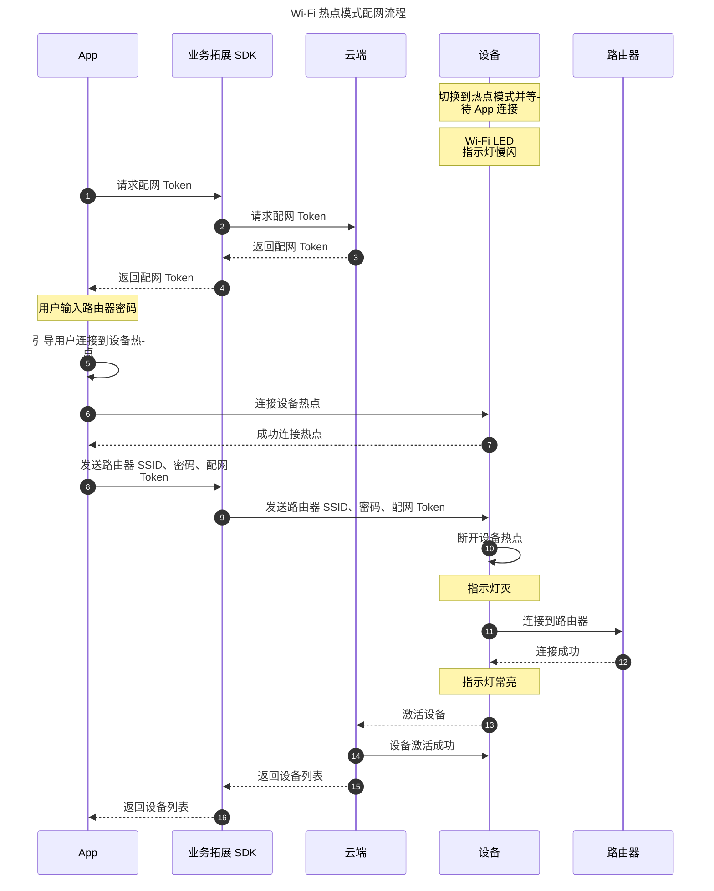

# Wi-Fi 热点模式
热点配网又称 **热点模式** 或 AP (Access Point) 配网，是一种通过 Wi-Fi 进行配网的连接能力。将手机连接到配网设备 Wi-Fi 热点后，设备与手机直接通过 Wi-Fi 进行通信配对。成功率高、可靠性好，可适配 2.4 GHz 和 5 GHz 混频路由器配网，但用户需要手动切换手机的 Wi-Fi 设置。

:::info
`ThingSmartBusinessExtensionKit` 组件提供了比 `ThingSmartActivator` 更多的功能。如果您仍直接在使用 `ThingSmartActivator`，请参考 [此链接](https://developer.tuya.com/docs/app-development/activator?id=Kaixw35qn5d1l)。
:::

<div style="display:none"> 
## 配网流程

<!-- -->


</div>

## 注册配网类型

基座初始化时，需要注册一下配网的类型，模式对应为 `ThingSmartActivatorTypeAPModel`。

**接口说明**

```objc
/// Initialize network configuration types
/// @param typeList Network configuration types
- (void)registerWithActivatorList:(NSArray<ThingSmartActivatorTypeModel *>*)typeList;
```

**参数说明**

| 参数 | 说明 |
| --- | --- |
| typeList | 配网类型列表 |

## 查询 Token

使用 SDK 获取配网 Token，然后进行热点模式配网。Token 的有效期为 10 分钟，且配置成功后就会失效。再次配网时，需要重新查询 Token。

**接口说明**

```objc
- (void)getTokenWithHomeId:(long long)homeId
                   success:(ThingSuccessString)success
                   failure:(ThingFailureError)failure;
```

**参数说明**

| 参数 | 说明 |
| --- | --- |
| homeId | 设备将要绑定到的家庭的 ID |
| success | 成功回调，返回配网 Token |
| failure | 失败回调，返回失败原因 |

## 开始搜索

开始搜索时，需要传入已注册的 `typeList`。

**接口说明**

```objc
/// Start searching
/// @param typeList Network configuration types
- (void)startSearch:(NSArray <ThingSmartActivatorTypeModel *>*)typeList;
```

**参数说明**

| 参数 | 说明 |
| --- | --- |
| typeList | 配网类型列表 |

## 停止搜索

**接口说明**

```objc
/// Stop searching
/// @param typeList Network configuration types
/// @param clearCache Whether to clear the cache
- (void)stopSearch:(NSArray <ThingSmartActivatorTypeModel *>*)typeList clearCache:(BOOL)clearCache;
```

**参数说明**

| 参数 | 说明 |
| --- | --- |
| typeList | 配网类型列表 |
| clearCache | 是否清空当前搜索设备缓存 |

## 搜索设备回调

Wi-Fi 热点配网成功之后，会通过搜索回调返回设备信息。如果失败，则会返回对应的失败信息。

### 发现设备回调

**接口说明**

```objc
/// Device search callback
/// @param service Search instance
/// @param type Network configuration type
/// @param device Discovered device
/// @param errorModel Error callback
- (void)activatorService:(id<ThingSmartActivatorSearchProtocol>)service
            activatorType:(ThingSmartActivatorTypeModel *)type
             didFindDevice:(nullable ThingSmartActivatorDeviceModel *)device
                     error:(nullable ThingSmartActivatorErrorModel *)errorModel;
```

**参数说明**

| 参数 | 说明 |
| --- | --- |
| service | 配网服务 |
| type | 配网类型，此处返回 `ThingSmartActivatorTypeAPModel` |
| device | 发现设备，返回此次配网的设备模型，失败时返回 `nil` |
| errorModel | 如果配网失败或者超时，返回此模型，成功时返回 `nil` |

### 设备信息更新回调

**接口说明**

```objc
/// Device information update or device rediscovered on a different channel
/// @param service Search instance
/// @param type Network configuration type
/// @param device Device model
- (void)activatorService:(id<ThingSmartActivatorSearchProtocol>)service
            activatorType:(ThingSmartActivatorTypeModel *)type
           didUpdateDevice:(ThingSmartActivatorDeviceModel *)device;
```

**参数说明**

| 参数 | 说明 |
| --- | --- |
| service | 配网服务 |
| type | 配网类型，此处返回 `ThingSmartActivatorTypeAPModel` |
| device | 返回变化的设备信息 |

## 错误码说明

配网失败或者配网超时的情况下，会返回 `ThingSmartActivatorErrorModel`。

```objc
@interface ThingSmartActivatorErrorModel : NSObject
@property (nonatomic, strong) ThingSmartActivatorDeviceModel *deviceModel;
@property (nonatomic) NSError *error;
@end
```

其中 error 对应的错误码，定义在 `ThingSmartActivatorDiscoveryError` 中。下表展示了常见错误与说明。

| 错误码 |配网错误 | 
| --- | --- |
| ThingSmartActivatorDiscoveryErrorTimeout | 配网超时。 |
| ThingSmartActivatorDiscoveryErrorDeviceAlreadyBound | 设备强绑定错误。该设备已经被用户绑定，无法被第二个用户绑定，需要第一个用户解绑才能完成配网操作。 | 
| ThingSmartActivatorDiscoveryErrorAPPUnsupportProduct |配网账号的 App 和产品没有绑定关系。 |
| ThingSmartActivatorDiscoveryErrorTokenExpired | Token 失效。 |
| ThingSmartActivatorDiscoveryErrorGuestNotSupportStrongBind | 游客模式无法对强绑定设备进行配网。 |
| ThingSmartActivatorDiscoveryErrorRemoteApiParamIllegal | 接口参数不合法。 |

## 示例代码

**Swift**

```swift
class APmodeConfigurationVC: UITableViewController {
    @IBOutlet weak var ssidTextField: UITextField!
    @IBOutlet weak var passwordTextField: UITextField!

    private var token: String = ""
    private var apType: ThingSmartActivatorTypeAPModel = {
        let type = ThingSmartActivatorTypeAPModel()
        type.type = ThingSmartActivatorType.AP
        type.typeName = NSStringFromThingSmartActivatorType(ThingSmartActivatorType.AP)
        type.timeout = 120
        return type
    }()

    lazy var discovery: ThingSmartActivatorDiscovery = {
        let discovery = ThingSmartActivatorDiscovery()
        discovery.register(withActivatorList: [self.apType])
        discovery.setupDelegate(self)
        discovery.loadConfig()
        return discovery
    }()

    private func startConfiguration() {
        guard let homeID = Home.current?.homeId else { return }
        SVProgressHUD.show(withStatus: NSLocalizedString("Requesting for Token", comment: ""))

        ThingSmartActivator.sharedInstance()?.getTokenWithHomeId(homeID, success: { [weak self] (token) in
            guard let self = self else { return }
            self.token = token ?? ""
            self.startConfiguration(with: self.token)
        }, failure: { (error) in
            let errorMessage = error?.localizedDescription ?? ""
            SVProgressHUD.showError(withStatus: errorMessage)
        })
    }

    private func startConfiguration(with token: String) {
        SVProgressHUD.show(withStatus: NSLocalizedString("Configuring", comment: ""))
        guard let homeID = Home.current?.homeId else { return }
        let ssid = ssidTextField.text ?? ""
        let password = passwordTextField.text ?? ""
        apType.ssid = ssid;
        apType.password = password;
        apType.token = self.token;
        apType.spaceId = homeID
        discovery.startSearch([apType])
    }
}
extension APmodeConfigurationVC: ThingSmartActivatorSearchDelegate {

    func activatorService(_ service: ThingSmartActivatorSearchProtocol, activatorType type: ThingSmartActivatorTypeModel, didFindDevice device: ThingSmartActivatorDeviceModel?, error errorModel: ThingSmartActivatorErrorModel?) {
        if (errorModel != nil) {
            // Error
            SVProgressHUD.showError(withStatus: errorModel?.error.localizedDescription)
            return
        }

        if (device != nil) {
            if device?.step == ThingActivatorStep.found {
                // device find
            }
        }
    }

    func activatorService(_ service: ThingSmartActivatorSearchProtocol, activatorType type: ThingSmartActivatorTypeModel, didUpdateDevice device: ThingSmartActivatorDeviceModel) {
        if device.step == ThingActivatorStep.intialized {
            // Success
            let name = device.name
            SVProgressHUD.showSuccess(withStatus: NSLocalizedString("Successfully Added \(name)", comment: "Successfully added one device."))
            navigationController?.popViewController(animated: true)
        }
    }
}
```

**Objective-C**

```objc
/// Get token
- (void)getToken {
    ThingSmartActivator *apActivator = [[ThingSmartActivator alloc] init];
    [apActivator getTokenWithHomeId:homeId success:^(NSString *token) {
        NSLog(@"getToken success: %@", token);
        [self startConfigWiFi：token];
    } failure:^(NSError *error) {
        NSLog(@"getToken failure: %@", error.localizedDescription);
    }];
}

/// Start config
- (void)startConfigWifi:(NSString *)token {
  ThingSmartActivatorTypeAPModel *apModel  = [[ThingSmartActivatorTypeAPModel alloc] init];
  apModel.type = ThingSmartActivatorTypeAP;
  apModel.typeName = NSStringFromThingSmartActivatorType(ThingSmartActivatorTypeAP);
  apModel.timeout = 120;
  apModel.ssid = ssid;
  apModel.password = password;
  apModel.token = token;
  apModel.spaceId = homeId;

  [self.discovery registerWithActivatorList:@[apModel]];
  [self.discovery setupDelegate:self];

  [self.discovery startSearch:@[apModel]];
}

- (void)activatorService:(id<ThingSmartActivatorSearchProtocol>)service activatorType:(ThingSmartActivatorTypeModel *)type didFindDevice:(ThingSmartActivatorDeviceModel *)device error:(ThingSmartActivatorErrorModel *)errorModel {

    if (errorModel) {
        [self _connectWifiError:errorModel];
        return;
    }

    if (device) {
        [self _handleDevice:device];
    }
}

- (void)activatorService:(id<ThingSmartActivatorSearchProtocol>)service activatorType:(ThingSmartActivatorTypeModel *)type didUpdateDevice:(ThingSmartActivatorDeviceModel *)device {
    if (device) {
        [self _handleDevice:device];
    }
}

- (void)_handleDevice:(ThingSmartActivatorDeviceModel *)device {
    ThingActivatorStep step = device.step;

    if (step == ThingActivatorStepFound) {
      // discovery the device
    } else if (step == ThingActivatorStepRegisted) {
      // device registe
    } else if (step == ThingActivatorStepIntialized) {
        /// activated successfully
    }
}

- (ThingSmartActivatorDiscovery *)discovery {
    if (!_discovery) {
        _discovery = [[ThingSmartActivatorDiscovery alloc] init];
    }
    return _discovery;
}

```